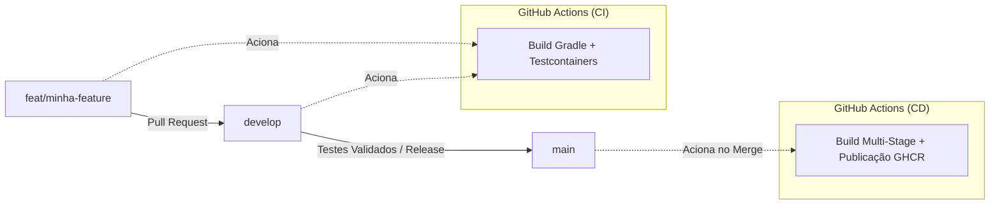

# 🎟️ Projeto Convite - Gestor de Eventos e Convites

[](https://github.com/paulopassos88/projeto-convite/actions/workflows/ci.yml)
[](https://github.com/paulopassos88/projeto-convite/actions/workflows/cd.yml)


API RESTful para gestão de eventos, lista de convidados, emissão/revogação de convites com token único e disparo assíncrono por e-mail via mensageria, construída com arquitetura moderna e boas práticas de engenharia de software.

---

## 📑 Sumário

1. [Tecnologias e Ferramentas](#-tecnologias-e-ferramentas)
2. [Pipeline de CI/CD e Estratégia de Branches](#️-pipeline-de-cicd-e-estratégia-de-branches)
3. [Configuração e Execução Local](#-configuração-e-execução-local)
4. [Documentação Interativa (Swagger UI)](#-documentação-interativa-swagger-ui)
5. [Como Usar a API (Guia Passo a Passo)](#-como-usar-a-api-guia-passo-a-passo)
   - [Passo 1: Autenticação (Login e Token JWT)](#passo-1-autenticação-login-e-token-jwt)
   - [Passo 2: Gestão de Usuários](#passo-2-gestão-de-usuários)
   - [Passo 3: Gestão de Eventos](#passo-3-gestão-de-eventos)
   - [Passo 4: Gestão de Convidados](#passo-4-gestão-de-convidados)
   - [Passo 5: Geração, Envio, Revogação e Reemissão de Convites](#passo-5-geração-envio-revogação-e-reemissão-de-convites)
6. [Tabela Consolidada de Endpoints e Permissões (RBAC)](#-tabela-consolidada-de-endpoints-e-permissões-rbac)
7. [Testando com Postman](#-testando-com-postman)

---

## 🚀 Tecnologias e Ferramentas

* **Linguagem & Framework:** Java 25, Spring Boot 4.1.0
* **Banco de Dados & Migrations:** PostgreSQL 16, Spring Data JPA, Flyway
* **Segurança & Autenticação:** Spring Security (Stateless), JWT (`jjwt`), RBAC (`ADMIN`, `ORGANIZADOR`, `PORTARIA`)
* **Mensageria:** Spring Boot AMQP com **RabbitMQ 3** (envio assíncrono de convites por e-mail)
* **Documentação da API:** SpringDoc OpenAPI 3 / Swagger UI
* **Testes Automatizados:** JUnit 5, MockMvc, **Testcontainers** (PostgreSQL real em contêiner Docker)
* **Containerização:** Docker (Dockerfile Multi-Stage) e Docker Compose
* **CI/CD:** GitHub Actions (Integração Contínua com Testcontainers + Entrega Contínua para GitHub Container Registry - GHCR)

---

## ⚙️ Pipeline de CI/CD e Estratégia de Branches

O projeto segue um fluxo baseado em **GitFlow simplificado**:



* **Branch `develop`:** Ambiente de integração contínua onde as features são reunidas e validadas.
* **Branch `main`:** Versão estável de produção. Cada merge na `main` dispara automaticamente o pipeline de CD.
* **CI com Testcontainers:** Todos os testes de integração sobem contêineres Docker reais de banco de dados automaticamente no runner do GitHub Actions antes da aprovação do código.

---

## 📦 Configuração e Execução Local

### Pré-requisitos
* **Java 25 (JDK)** (para execução local fora do Docker ou execução de testes via Gradle)
* **Docker** e **Docker Compose**

### 1. Clonar o repositório
```bash
git clone https://github.com/paulopassos88/projeto-convite.git
cd projeto-convite
```

### 2. Configurar variáveis de ambiente (Opcional)
O `docker-compose.yml` já possui valores padrão prontos para desenvolvimento. Caso deseje customizá-los, copie o arquivo `.env.example` para `.env`:

```bash
cp .env.example .env
```

| Variável | Descrição | Valor Padrão |
| :--- | :--- | :--- |
| `POSTGRES_DB` | Nome do banco de dados PostgreSQL | `convite_db` |
| `POSTGRES_USER` | Usuário do banco de dados | `postgres` |
| `POSTGRES_PASSWORD` | Senha do banco de dados | `postgres` |
| `RABBITMQ_USER` | Usuário do RabbitMQ | `guest` |
| `RABBITMQ_PASSWORD` | Senha do RabbitMQ | `guest` |
| `JWT_SECRET` | Chave secreta para assinatura de tokens JWT (mín. 32 caracteres) | `12345678901234567890123456789012` |
| `API_PORT` | Porta HTTP exposta pela API no host | `8080` |

### 3. Subir o ambiente completo com Docker Compose
```bash
docker compose up -d --build
```

Após a inicialização dos contêineres (`convite-db`, `convite-rabbitmq` e `convite-api`), os seguintes serviços estarão disponíveis:

| Serviço | URL / Endereço | Credenciais Padrão |
| :--- | :--- | :--- |
| **API Base URL** | `http://localhost:8080/api/v1` | Admin inicial: `admin@convite.com` / `admin123` |
| **Swagger UI** | `http://localhost:8080/api/v1/swagger-ui/index.html` | Público (use o botão **Authorize** para JWT) |
| **OpenAPI JSON** | `http://localhost:8080/api/v1/v3/api-docs` | Público |
| **RabbitMQ Management** | `http://localhost:15672` | `guest` / `guest` |
| **PostgreSQL** | `localhost:5432` (database `convite_db`) | `postgres` / `postgres` |

### 4. Executar os testes de integração localmente
Certifique-se de que o Docker esteja em execução (necessário para o **Testcontainers**):

```bash
cd api-convite
./gradlew test
```

---

## 📄 Documentação Interativa (Swagger UI)

Com a aplicação rodando, acesse no navegador:

👉 **[http://localhost:8080/api/v1/swagger-ui/index.html](http://localhost:8080/api/v1/swagger-ui/index.html)**

### Como autenticar no Swagger UI:
1. Expanda a seção **`1. Autenticação`** e execute o endpoint `POST /auth/login` utilizando as credenciais padrão (`admin@convite.com` / `admin123`).
2. Copie o valor do campo `token` retornado no corpo da resposta.
3. Clique no botão **`Authorize` 🔒** no canto superior direito da página do Swagger.
4. No campo `Value`, cole **apenas o token JWT** (sem a palavra `Bearer`) e clique em **Authorize**.
5. Pronto! Todas as chamadas subsequentes feitas pelo Swagger UI enviarão automaticamente o cabeçalho `Authorization: Bearer <token>`.

---

## 🧭 Como Usar a API (Guia Passo a Passo)

Todas as rotas da API utilizam o prefixo base:
```text
http://localhost:8080/api/v1
```

---

### Passo 1: Autenticação (Login e Token JWT)

Na primeira execução, o Flyway cria automaticamente um usuário administrador padrão:
* **E-mail:** `admin@convite.com`
* **Senha:** `admin123`

#### `POST /api/v1/auth/login`
```bash
curl -X POST http://localhost:8080/api/v1/auth/login \
  -H "Content-Type: application/json" \
  -d '{
    "email": "admin@convite.com",
    "senha": "admin123"
  }'
```

**Resposta (`200 OK`):**
```json
{
  "token": "eyJhbGciOiJIUzI1NiJ9...",
  "tipo": "Bearer"
}
```

> 💡 **Importante:** Nas requisições seguintes, envie o token obtido no cabeçalho HTTP:
> `Authorization: Bearer <SEU_TOKEN_JWT>`

---

### Passo 2: Gestão de Usuários

#### 2.1 Cadastrar novo usuário (Exclusivo `ADMIN`) — `POST /api/v1/usuarios`
Perfis disponíveis: `ADMIN`, `ORGANIZADOR`, `PORTARIA`.

```bash
curl -X POST http://localhost:8080/api/v1/usuarios \
  -H "Authorization: Bearer <SEU_TOKEN_JWT>" \
  -H "Content-Type: application/json" \
  -d '{
    "nome": "João Organizador",
    "email": "organizador@convite.com",
    "senha": "senhaForte123",
    "perfil": "ORGANIZADOR"
  }'
```

**Resposta (`201 Created`):**
```json
{
  "id": "660e8400-e29b-41d4-a716-446655440001",
  "nome": "João Organizador",
  "email": "organizador@convite.com",
  "perfil": "ORGANIZADOR",
  "ativo": true,
  "criadoEm": "2026-10-16T15:00:00"
}
```

#### 2.2 Consultar dados do próprio usuário autenticado — `GET /api/v1/usuarios/me`
```bash
curl -X GET http://localhost:8080/api/v1/usuarios/me \
  -H "Authorization: Bearer <SEU_TOKEN_JWT>"
```

---

### Passo 3: Gestão de Eventos

Usuários com perfil `ORGANIZADOR` ou `ADMIN` podem criar e gerenciar eventos. Um `ORGANIZADOR` possui acesso apenas aos eventos que ele próprio criou, enquanto o `ADMIN` possui visão global.

#### 3.1 Criar um evento — `POST /api/v1/eventos`
> **Regras:** `dataInicio` deve ser uma data futura e `dataFim` deve ser posterior a `dataInicio` (RN-005).

```bash
curl -X POST http://localhost:8080/api/v1/eventos \
  -H "Authorization: Bearer <SEU_TOKEN_JWT>" \
  -H "Content-Type: application/json" \
  -d '{
    "nome": "Festa de Confraternização 2027",
    "descricao": "Evento anual da empresa com jantar e música ao vivo.",
    "local": "Espaço Villa Lobos - São Paulo/SP",
    "dataInicio": "2027-12-15T19:00:00",
    "dataFim": "2027-12-15T23:59:00",
    "limiteConvidados": 150
  }'
```

**Resposta (`201 Created`):**
```json
{
  "id": "550e8400-e29b-41d4-a716-446655440000",
  "nome": "Festa de Confraternização 2027",
  "descricao": "Evento anual da empresa com jantar e música ao vivo.",
  "local": "Espaço Villa Lobos - São Paulo/SP",
  "dataInicio": "2027-12-15T19:00:00",
  "dataFim": "2027-12-15T23:59:00",
  "limiteConvidados": 150,
  "status": "ATIVO",
  "organizadorId": "660e8400-e29b-41d4-a716-446655440001",
  "criadoEm": "2026-10-16T15:05:00"
}
```

#### 3.2 Listar eventos com paginação — `GET /api/v1/eventos`
```bash
curl -X GET "http://localhost:8080/api/v1/eventos?page=0&size=10&sort=dataInicio,asc" \
  -H "Authorization: Bearer <SEU_TOKEN_JWT>"
```

#### 3.3 Buscar, Atualizar ou Cancelar Evento
* **Buscar por ID:** `GET /api/v1/eventos/{eventoId}`
* **Atualizar:** `PUT /api/v1/eventos/{eventoId}` *(não permite reduzir `limiteConvidados` abaixo do total já alocado na lista)*
* **Cancelar (Soft Delete):** `DELETE /api/v1/eventos/{eventoId}` *(altera o status para `CANCELADO`, retornando `204 No Content`)*

---

### Passo 4: Gestão de Convidados

Cada convidado ocupa `1 + limiteAcompanhantes` vagas na capacidade máxima do evento (`limiteConvidados`). Não é permitido cadastrar dois convidados com o mesmo e-mail no mesmo evento.

#### 4.1 Adicionar convidado ao evento — `POST /api/v1/eventos/{eventoId}/convidados`
```bash
curl -X POST http://localhost:8080/api/v1/eventos/550e8400-e29b-41d4-a716-446655440000/convidados \
  -H "Authorization: Bearer <SEU_TOKEN_JWT>" \
  -H "Content-Type: application/json" \
  -d '{
    "nome": "Maria Oliveira",
    "email": "maria.oliveira@email.com",
    "telefone": "11999998888",
    "limiteAcompanhantes": 2
  }'
```

**Resposta (`201 Created`):**
```json
{
  "id": "770e8400-e29b-41d4-a716-446655440002",
  "nome": "Maria Oliveira",
  "email": "maria.oliveira@email.com",
  "telefone": "11999998888",
  "limiteAcompanhantes": 2,
  "eventoId": "550e8400-e29b-41d4-a716-446655440000",
  "criadoEm": "2026-10-16T15:10:00"
}
```

#### 4.2 Listar convidados (com filtro opcional por nome ou e-mail) — `GET /api/v1/eventos/{eventoId}/convidados`
```bash
curl -X GET "http://localhost:8080/api/v1/eventos/550e8400-e29b-41d4-a716-446655440000/convidados?busca=Maria&page=0&size=10" \
  -H "Authorization: Bearer <SEU_TOKEN_JWT>"
```

---

### Passo 5: Geração, Envio, Revogação e Reemissão de Convites

#### 5.1 Gerar convite para um convidado — `POST /api/v1/eventos/{eventoId}/convidados/{convidadoId}/convite`
Gera um convite único com status inicial `PENDENTE` e um token exclusivo.

```bash
curl -X POST http://localhost:8080/api/v1/eventos/550e8400-e29b-41d4-a716-446655440000/convidados/770e8400-e29b-41d4-a716-446655440002/convite \
  -H "Authorization: Bearer <SEU_TOKEN_JWT>"
```

**Resposta (`201 Created`):**
```json
{
  "id": "880e8400-e29b-41d4-a716-446655440003",
  "token": "a1b2c3d4-e5f6-7890-abcd-ef1234567890",
  "status": "PENDENTE",
  "convidadoId": "770e8400-e29b-41d4-a716-446655440002",
  "nomeConvidado": "Maria Oliveira",
  "emailConvidado": "maria.oliveira@email.com",
  "limiteAcompanhantes": 2,
  "dataResposta": null,
  "criadoEm": "2026-10-16T15:15:00"
}
```

#### 5.2 Solicitar envio do convite por e-mail (Assíncrono via RabbitMQ) — `POST /api/v1/convites/{conviteId}/enviar`
Publica o evento de disparo na fila `convite.envio.email.queue` do RabbitMQ e retorna imediatamente ao cliente.

```bash
curl -X POST http://localhost:8080/api/v1/convites/880e8400-e29b-41d4-a716-446655440003/enviar \
  -H "Authorization: Bearer <SEU_TOKEN_JWT>"
```

**Resposta (`200 OK`):**
```json
{
  "mensagem": "Solicitação de envio de convite encaminhada para processamento."
}
```

#### 5.3 Revogar um convite — `PATCH /api/v1/convites/{conviteId}/revogar`
Invalida imediatamente o convite (alterando seu status para `REVOGADO`), impedindo novos envios de e-mail ou confirmações de presença com o token antigo.

```bash
curl -X PATCH http://localhost:8080/api/v1/convites/880e8400-e29b-41d4-a716-446655440003/revogar \
  -H "Authorization: Bearer <SEU_TOKEN_JWT>"
```
**Resposta:** `204 No Content`

#### 5.4 Reemitir um convite revogado
Se um convidado tiver seu convite com status `REVOGADO`, basta chamar novamente o endpoint de geração (`POST /api/v1/eventos/{eventoId}/convidados/{convidadoId}/convite`). O sistema reaproveitará o registro existente, gerará um **novo token único**, limpará a `dataResposta` e restaurará o status para `PENDENTE`.

---

## 🔐 Tabela Consolidada de Endpoints e Permissões (RBAC)

| Módulo | Método | Endpoint | Descrição | Perfis Permitidos |
| :--- | :---: | :--- | :--- | :--- |
| **Autenticação** | `POST` | `/api/v1/auth/login` | Autentica usuário e retorna token JWT | Público |
| **Usuários** | `POST` | `/api/v1/usuarios` | Cadastra novo usuário no sistema | `ADMIN` |
| **Usuários** | `GET` | `/api/v1/usuarios` | Lista todos os usuários cadastrados | `ADMIN` |
| **Usuários** | `GET` | `/api/v1/usuarios/me` | Retorna dados do usuário autenticado | Autenticado (Todos) |
| **Usuários** | `PATCH` | `/api/v1/usuarios/{id}/desativar` | Desativa um usuário | `ADMIN` |
| **Eventos** | `POST` | `/api/v1/eventos` | Cria um novo evento | `ADMIN`, `ORGANIZADOR` |
| **Eventos** | `GET` | `/api/v1/eventos` | Lista eventos ativos paginados | `ADMIN`, `ORGANIZADOR`* |
| **Eventos** | `GET` | `/api/v1/eventos/{id}` | Busca detalhes de um evento | `ADMIN`, `ORGANIZADOR`* |
| **Eventos** | `PUT` | `/api/v1/eventos/{id}` | Atualiza dados de um evento ativo | `ADMIN`, `ORGANIZADOR`* |
| **Eventos** | `DELETE` | `/api/v1/eventos/{id}` | Cancela um evento (Soft Delete) | `ADMIN`, `ORGANIZADOR`* |
| **Convidados** | `POST` | `/api/v1/eventos/{eventoId}/convidados` | Adiciona convidado ao evento | `ADMIN`, `ORGANIZADOR`* |
| **Convidados** | `GET` | `/api/v1/eventos/{eventoId}/convidados` | Lista convidados do evento (paginado) | `ADMIN`, `ORGANIZADOR`* |
| **Convidados** | `GET` | `/api/v1/eventos/{eventoId}/convidados/{id}` | Busca convidado por ID | `ADMIN`, `ORGANIZADOR`* |
| **Convidados** | `PUT` | `/api/v1/eventos/{eventoId}/convidados/{id}` | Atualiza dados do convidado | `ADMIN`, `ORGANIZADOR`* |
| **Convidados** | `DELETE` | `/api/v1/eventos/{eventoId}/convidados/{id}` | Remove convidado do evento | `ADMIN`, `ORGANIZADOR`* |
| **Convites** | `POST` | `/api/v1/eventos/{eventoId}/convidados/{convidadoId}/convite` | Gera novo convite ou reemite convite revogado | `ADMIN`, `ORGANIZADOR`* |
| **Convites** | `GET` | `/api/v1/eventos/{eventoId}/convites` | Lista convites do evento (filtro opcional `status`) | `ADMIN`, `ORGANIZADOR`* |
| **Convites** | `GET` | `/api/v1/eventos/{eventoId}/convites/{id}` | Busca convite por ID | `ADMIN`, `ORGANIZADOR`* |
| **Convites** | `GET` | `/api/v1/eventos/{eventoId}/convidados/{convidadoId}/convite` | Busca convite pelo ID do convidado | `ADMIN`, `ORGANIZADOR`* |
| **Convites** | `POST` | `/api/v1/convites/{id}/enviar` | Enfileira envio de convite por e-mail (RabbitMQ) | `ADMIN`, `ORGANIZADOR`* |
| **Convites** | `PATCH` | `/api/v1/convites/{id}/revogar` | Revoga convite ativo | `ADMIN`, `ORGANIZADOR`* |

> \* **Nota de Escopo (`ORGANIZADOR`):** Usuários com perfil `ORGANIZADOR` somente podem visualizar e operar sobre eventos (e respectivos convidados/convites) dos quais sejam o organizador responsável. Tentativas de acesso a recursos de outros organizadores retornam `403 Forbidden`.

---

## 📬 Testando com Postman

O repositório inclui uma coleção completa do Postman em [`http/api-collection.json`](http/api-collection.json) com scripts de automação integrados:

1. Abra o **Postman** e clique em **Import**.
2. Selecione o arquivo `http/api-collection.json`.
3. As variáveis de coleção já vêm pré-configuradas (`baseUrl = http://localhost:8080/api/v1`).
4. Execute primeiro a requisição **`1. Autenticação > Login Admin`** (ou `Login Organizador`): o script de pós-resposta salvará automaticamente o token JWT nas variáveis `jwtToken` / `organizadorToken`.
5. Da mesma forma, ao criar um Evento, Convidado ou Convite pela coleção, os IDs gerados (`eventoId`, `convidadoId`, `conviteId`, `conviteToken`) são capturados e preenchidos automaticamente para as requisições seguintes.
